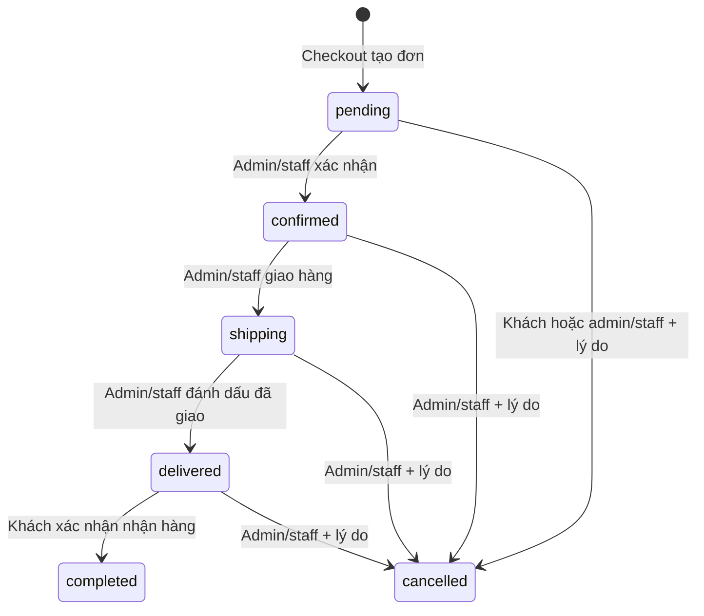

# TechMobile — quy tắc nghiệp vụ

**Quy tắc bổ sung 02/11/2026:** [OPERATIONS_REPORTING.md](OPERATIONS_REPORTING.md) quy định phiếu nhập, nhà cung cấp, snapshot giá vốn, timeline và báo cáo đã được duyệt. Doanh thu theo completedAt; ghi nhận thanh toán theo ledger/paidAt, tách điều chỉnh demo. Thiếu giá vốn không bằng 0; snapshot đã biết không đổi khi điều chỉnh giá nhập. Admin có lệnh bổ sung snapshot còn thiếu với lý do. Không có công nợ/hoàn tiền tự động trong phạm vi mới.

**Quy tắc hiện hành cập nhật 17/10/2026:** [IMEI_WARRANTY.md](IMEI_WARRANTY.md) thay thế các phần “Hiện tại” liên quan bên dưới. Phần còn lại là snapshot audit trước thay đổi.

**Bổ sung 23/10:** Máy chờ nhận lại phải có device return_pending và IMEI gắn đúng dòng đơn; đơn hủy cũ không có dữ liệu IMEI không tự trở thành hàng chờ nhận về. Nhận máy xong giữ snapshot lịch sử. Đã phân bổ (chờ giao), Đang giao và Đã bán là các số đếm trạng thái allocated/shipping/sold tách biệt, không phải các số phải bằng nhau.

- Mỗi máy đúng một IMEI string 15 chữ số duy nhất, không IMEI phụ. IMEI sinh cho dữ liệu mô phỏng cũ giữ nguyên giá trị, origin=demo_migration và simulated trong snapshot; bỏ nhãn Demo ở UI. Không tuyên bố đã được nhà sản xuất xác minh.
- Xác nhận pending tự gán đủ IMEI mọi dòng theo đúng cặp productId/variantId, FIFO receivedAt rồi ID; giữ phân bổ đã có. Thiếu hàng hoặc lỗi lưu không xác nhận/ghi một phần. Retry không gán lại. confirmed dùng nguyên máy đã gán khi shipping; thay máy qua API trước giao phải giữ đủ số lượng. Lịch sử assignmentHistory không bị xóa khi giải phóng máy.
- Tồn theo cặp productId/variantId = available devices trừ giữ chỗ chưa phân bổ. Không cộng/trừ quantity phía client; phân bổ không trừ thêm lần nữa.
- Thuật ngữ UI kho: **Đang xử lí** = máy của đơn chưa gán IMEI + allocated, **Sẵn bán** = available trừ phần chưa gán (ngừng bán thì 0), **Tổng kho** = available + allocated + quarantine. Bộ lọc hãng/dòng/RAM-dung lượng/màu không thay đổi ID hoặc cơ chế tồn. **Bảo hành** đếm máy có phiếu đang mở, có thể trùng với Đã bán; không phải số quyền còn hạn và không cộng vào tồn. Xem cách tính tại IMEI_WARRANTY.md.
- Đặt hàng, chuyển trạng thái, phân bổ, hủy và nhận lại được xử lý cùng snapshot, kiểm revision/idempotency. Khách chỉ hủy pending, staff/admin chưa completed; shipping phải đủ máy. Hủy sau giao chờ nhận lại/quarantine, không hoàn tồn bán ngay.
- delivered kích hoạt bảo hành theo snapshot số tháng của variant; customer completed vẫn là bước riêng, COD paid đồng thời. Mỗi lần tiếp nhận có claim/history; máy sửa bảo hành không thành hàng bán được.
- Login do server cấp token; API kiểm user active/role/ownership. Legacy password chưa hash và hệ thống vẫn chỉ demo loopback. ProductManager bảo toàn variants/specs; biến thể có máy không đổi màu/storage hoặc xóa.

Snapshot **16/10/2026**. “Hiện tại” dưới đây mô tả code, không phải khẳng định mọi quy tắc đã được server bảo vệ. “Mong muốn” lấy từ yêu cầu tiếp nhận, là định hướng cho công việc được chọn sau này.

## 1. Đơn hàng

Luồng mục tiêu, cũng là luồng các nút UI hiện tại:

| Quy tắc | Code thực thi hiện tại | Mong muốn/khoảng trống |
|---|---|---|
| Tạo đơn | Checkout yêu cầu currentUser, cart có item, ba trường nhận hàng không rỗng; status pending | Xác minh user active, form hợp lệ và toàn bộ mặt hàng tại server; tránh tạo lặp |
| Xác nhận/giao | OrderManager có guard pending/confirmed trong handleConfirmOrder/handleShippingOrder | Guard phải dựa trạng thái mới nhất và server, không chỉ object đã tải |
| Đã giao | Nút chỉ bật ở shipping; handleMarkDelivered PATCH delivered + deliveredAt | Handler không tự check shipping; cần điều kiện cập nhật nguyên tử |
| Hoàn thành | OrderHistory kiểm tra order.status=delivered, confirm, PATCH completed + completedAt | Kiểm tra quyền sở hữu và trạng thái mới nhất ở server; quyết định rõ BANK chưa paid |
| Admin không hoàn thành trực tiếp | UI không gọi handleCompleteOrder; handler shipping→completed cũ còn nhưng unused | Không nối lại handler cũ; khi sửa được yêu cầu nên loại bỏ logic trái luồng |
| Không tự hoàn thành sau ba ngày | Không thấy timer/cron theo đơn trong source | Giữ yêu cầu này |
| Giữ lịch sử | UI không có nút xóa order đang hoạt động | handleDelete cũ và json-server DELETE vẫn tồn tại; API thật sau này phải bảo toàn lịch sử |
| Thời điểm | createdAt, deliveredAt, completedAt, cancelledAt bằng toLocaleDateString vi-VN | Dữ liệu cũ thiếu nhiều mốc; timestamp ISO + timezone và lịch sử chuyển trạng thái là backlog |

Không có state machine dùng chung hoặc timeline sự kiện. Status text/badge lặp ở Dashboard/OrderHistory/OrderManager/Invoice; Invoice thiếu delivered.

## 2. Thanh toán

### COD

Checkout luôn tạo `paymentStatus='unpaid'`, `paidAt=null`, `paidBy=null`. Khi khách xác nhận nhận hàng, OrderHistory thêm `paymentStatus='paid'`, `paidAt=today`, `paidBy='customer_cod'` cùng `status='completed'`.

OrderManager không cho đổi select thanh toán với COD, handler cũng trả về cảnh báo. Thời điểm chỉ là ngày, chưa có giờ hoặc bằng chứng thu tiền riêng. Dữ liệu cũ có 7/12 đơn completed thiếu paymentStatus; cần xác minh/migration có chủ đích, không tự đánh dấu toàn bộ paid.

### BANK

Hiện tại chỉ có lựa chọn `paymentMethod='BANK'`. Không có mã QR VietQR, thông tin tài khoản nhận, mã/nội dung chuyển khoản lưu vào đơn hoặc webhook. Admin/staff được đổi non-COD paid/unpaid bằng select; paid lưu `paidBy='admin'` và ngày, unpaid xóa hai field này. Không có khóa theo cancelled/completed hoặc thông tin người thao tác thực tế.

Mong muốn: checkout hiển thị QR/nội dung định danh đơn, vẫn unpaid cho đến khi quản trị kiểm tra và đánh dấu. VietQR tạo thông tin chuyển khoản không chứng minh giao dịch thành công. Tự xác thực VNPay/MoMo/ngân hàng chỉ thuộc backlog backend/callback có kiểm chứng.

Khách hiện có thể hoàn thành BANK delivered còn unpaid vì nhánh xác nhận chỉ cập nhật paid cho COD. Đây là điều kiện nghiệp vụ chưa chốt trong code. Dashboard chỉ dựa completed khi tính doanh thu, nên phải thống nhất định nghĩa doanh thu, trạng thái thanh toán và xử lý hoàn tiền trước khi mở rộng. Hủy đơn paid hiện không tạo refund transaction hoặc đổi paymentStatus.

## 3. Sản phẩm và biến thể

- Product có quantity/status và thông số gốc. 35 sản phẩm có tổng 274 variants: id/color/storage/price/oldPrice/image, ram tùy bản ghi; không tồn kho variant.
- Detail lấy variant đầu làm mặc định; đổi color có tìm dung lượng hợp lệ thay thế. Đổi storage không tìm lại color hợp lệ. Nếu không thấy cặp, displayProduct fallback product gốc. Dữ liệu hiện đủ tổ hợp nên nhánh này là rủi ro dữ liệu tương lai.
- Khi tìm thấy variant, Detail tạo `cartKey=productId-variantId`, copy price/oldPrice/image/storage/color/variantId/productId và thêm storage vào name. Không áp dụng variant.ram vào specs hay snapshot display; specs vẫn đọc product gốc.
- Mua trực tiếp từ Card/related thêm product gốc, không buộc chọn variant mặc dù product có variants. Wishlist bỏ định danh variant. Không thể coi tất cả đường thêm hàng đã chuẩn hóa cùng một SKU.
- ProductManager không có form variant. `PUT productData` khi sửa bỏ variants và ghi lại nhóm specs bằng giá trị mặc định. Không được dùng thao tác sửa hiện tại trên dữ liệu quan trọng nếu chưa có bản sao và sửa lỗi được yêu cầu.

Mong muốn: định danh variant nhất quán, giá/ảnh/specs/tồn phù hợp từng màu/dung lượng, chỉ cho mua tổ hợp hợp lệ. Chuẩn hóa variantId vào order items trước khi quản lý IMEI/bảo hành; không tự di trú dữ liệu trong audit.

## 4. Ngừng bán

ProductManager PATCH `inactive` để ngừng, `active` để bán lại, không có DELETE products. ProductList lọc active và cả vài trạng thái tiếng Việt/thiếu field cũ; helper/Card/Detail chỉ chấp nhận chính xác active. Snapshot db hiện tất cả active.

Truy cập detail trực tiếp tới inactive vẫn hiển thị sản phẩm; nút mua chính disabled. Home và related vẫn có thể hiển thị inactive nhưng helper chặn add. Compare.handleAddCart tự ghi storage và không check status/tồn. Checkout fetch lại status, nên đường Compare hiện cho thêm inactive vào giỏ nhưng không đủ để kết luận đặt đơn inactive thành công qua checkout chuẩn.

Mong muốn: thống nhất diễn giải status và mọi điểm thêm hàng; giữ xem snapshot đơn cũ, không xóa sản phẩm đã phát sinh lịch sử. Việc có cho xem detail inactive hay không cần giữ theo yêu cầu sản phẩm, không tự chuyển thành 404.

## 5. Tồn kho và đặt hàng

| Bước | Hiện tại | Hệ quả/đích đến |
|---|---|---|
| Add cart | Helper kiểm tra active và quantity snapshot, giới hạn từng cartKey | Không xác minh tổng cùng product; quantity undefined từ wishlist qua được phép so sánh |
| Đổi số lượng | Cart min 1/max item.quantity snapshot | Không phải tồn kho mới nhất, không bảo vệ nhiều tab/người mua |
| Pre-check checkout | GET từng product, kiểm active, quantity>0 và cartQuantity<=quantity | Không cộng gộp cùng product, không kiểm số nguyên dương/hữu hạn, không đối chiếu variant/giá |
| Tạo đơn | POST orders trước khi trừ kho | Đơn có thể tồn tại dù PATCH kho thất bại |
| Trừ kho | GET/PATCH từng dòng tuần tự | Không atomic/lock/version/idempotency; race giữa nhiều phiên; không rollback |
| Hoàn kho | GET/PATCH từng item trước PATCH cancelled | Có thể hoàn hai lần/dở dang hoặc ghi đè cập nhật đồng thời |

Đã chạy handler checkout thật với API giả: stock=5, hai cartKey cùng product mua 4+4 đều qua pre-check và sau trừ còn **-3**. Đã mô phỏng PATCH kho lỗi sau POST: đơn vẫn tồn tại, cart chưa xóa. Không có stock movement log/reservation hoặc cơ chế retry an toàn.

Mong muốn: server kiểm tra và thực hiện tạo đơn/trừ kho cùng giao dịch, tổng hợp theo SKU đúng, giá/tồn mới nhất, idempotency key; hủy/hoàn đúng một lần. Trong stack demo hiện tại có thể cải thiện kiểm tra client trước, nhưng không mô tả việc đó là giải quyết hoàn toàn cạnh tranh đồng thời.

## 6. Hủy đơn

Khách mở modal chỉ khi pending. Admin/staff có nút disabled khi completed/cancelled. Hai form đều yêu cầu `cancelReason.trim()`; handler submit không kiểm tra lại trạng thái/ownership mới nhất, không khóa nút đang gửi. `cancelledBy` lưu chuỗi customer hoặc admin (staff cũng ghi admin), cancelledAt là ngày.

Cả hai nhánh đều hoàn kho trước, rồi PATCH order cancelled. Không có stockRestored, cancellation transaction ID hoặc compare-and-set. Kiểm chứng gọi lại handler khách hai lần với quantity=2: tồn 5→7→9, dù nghiệp vụ chỉ được hoàn 2. Không tuyên bố dữ liệu demo đã bị hoàn hai lần; đây là hành vi tái hiện bằng fixture.

Mong muốn: chỉ chấp nhận chuyển trạng thái hợp lệ một lần, lý do bắt buộc, hoàn đúng một lần theo mặt hàng thực tế, xử lý lỗi có thể retry, không xóa order. Đơn đã trả tiền cần chính sách hoàn tiền riêng trước khi coi hủy là hoàn tất tài chính.

## 7. Giá, snapshot và coupon

Checkout dùng `item.price` từ localStorage để tính và ghi order, dù đã fetch latestProduct. Không so sánh với giá product/variant mới. Đã xác nhận handler chấp nhận giá fixture 1 khi API trả giá 100. Không coi localStorage là nguồn tin cậy.

Order giữ `{productId,name,price,quantity,image}`; bảo toàn tên/giá/ảnh nếu product đổi sau này, nhưng thiếu variantId/color/storage/cartKey. Các dòng cùng dung lượng khác màu mất khả năng phân biệt trong hóa đơn và lịch sử. Checkout tính productTotal/productDiscount cho UI nhưng không lưu hai field đó trong newOrder; dữ liệu lịch sử có field, gây lệch hiển thị invoice giữa các thế hệ đơn.

Coupon: tìm không phân biệt hoa thường và trim input, yêu cầu active tại lúc apply. discountType amount cap theo tổng, còn lại mặc định percent; finalTotal clamp >=0. Quản trị validate discount>0, percent<=100, amount>=1000, kiểm code trùng không phân biệt hoa thường; code khi lưu uppercase nhưng chưa trim. Không expiry, usage cap, minimum order, hoặc tái kiểm tra active/discount lúc submit. Snapshot coupon trong order chỉ lưu code/discountType/discount, không liên kết bản ghi sống.

## 8. Wishlist, compare, tài khoản và storage

Wishlist hiện lưu snapshot id/name/price/oldPrice/image/brand/storage/rating/reviews/status, thiếu quantity/variant/specs đầy đủ. Key `wishlist` chung trình duyệt, không gắn userId, dùng được khi chưa đăng nhập. Helper normalize ID bằng String; toggle/remove phát wishlistUpdated. Page Wishlist nghe event; Card/Detail không nghe để cập nhật tim ở component đã mount.

Compare helper dùng strict product.id, tối đa 3, modal yêu cầu ít nhất 2. So sánh theo product, không phải variant. Page Compare có logic riêng: remove/clear không phát compareUpdated, không subscribe helper, add cart merge theo id và không validate status/tồn. Vì FloatingPanels vẫn xuất hiện ở `/compare`, có thể nhìn hai danh sách khác nhau trên cùng trang.

cart/compareList/wishlist không được xóa hoặc chuyển namespace khi logout/login; tài khoản B cùng trình duyệt thấy dữ liệu mua sắm của A. currentUser là snapshot, không có session/token server. Các JSON.parse không try/catch/type validation, nên chuỗi JSON hỏng hoặc shape sai có thể làm lỗi render/handler.

Mong muốn: quyết định rõ dữ liệu guest và dữ liệu theo tài khoản, cơ chế merge/sync, chỉ lưu định danh cần thiết và hydrate product mới. Không tự xóa dữ liệu trình duyệt hoặc tạo wishlist backend khi chưa được yêu cầu.

## 9. Review

UI chỉ bật nút khi order completed; hasReviewed dùng strict userId/orderId/productId đối chiếu array reviews đã tải. Nội dung phải trim không rỗng; rating lấy select 1–5. Handler chỉ kiểm modal order/product tồn tại và chưa có review local, không kiểm tra lại completed/ownership/giới hạn rating tại server.

POST review trước, sau đó GET toàn reviews, tính trung bình làm tròn nguyên, PATCH product.rating/reviews. Nếu PATCH lỗi review vẫn tồn tại; nhiều phiên có thể tạo trùng hoặc ghi thống kê cũ. Không có unique key server. Dữ liệu hiện có 5 review, không trùng khóa và đều trỏ đến completed, không chứng minh code ngăn lỗi.

Mong muốn: server kiểm người mua và item trong đơn completed, unique user/order/product (hoặc variant nếu nghiệp vụ chọn), rating hợp lệ, cập nhật thống kê đáng tin cậy. Không tự thay điều kiện một review mỗi đơn hay mỗi sản phẩm khi chưa thống nhất.

## 10. Phân quyền, tài khoản và bảo toàn dữ liệu

| Nhóm | UI đang cho phép | Hạn chế |
|---|---|---|
| Guest | Browse/cart/wishlist/compare, login/register | Checkout submit yêu cầu local user; các GET vẫn công khai |
| Customer | Profile, đơn của userId trong browser, các thao tác khách | Không có server ownership enforcement |
| Staff | Dashboard, products, orders | Được sửa kho/sản phẩm và BANK paid như admin tại các trang này |
| Admin | Tất cả admin routes | UserManager quản mọi role, StaffManager subset admin/staff |

Login GET toàn users và so sánh password plain, chỉ chặn blocked tại đăng nhập. currentUser không có password nhưng role/status có thể sửa trong storage. ProtectedRoute chỉ xem role, không xem blocked. Profile/checkout/order handlers không thu hồi phiên nếu server khóa tài khoản sau login. Đổi password ở Profile không yêu cầu password cũ.

User/Staff manager có nút khóa/mở, chặn khóa admin bằng toggle handler; form sửa vẫn cho đổi role/status, không bảo vệ last admin hoặc tự hạ quyền. PUT form không giữ createdAt. Nút delete users/staff/categories/coupons đã comment, DELETE handlers còn; không coi đây là thao tác xóa khả dụng trên UI hiện tại.

Mong muốn: giữ quan hệ và khóa thay xóa; bảo vệ admin cuối cùng; authorization và password hashing tại backend khi được chọn phát triển. `db.json` đang tracked, có trường thông tin tài khoản/nhận hàng; chưa xác minh đó là dữ liệu giả hoàn toàn. Không đưa thông tin nhạy cảm vào báo cáo hoặc push tự động.

## 11. Báo cáo doanh thu

Hiện revenue = tổng totalPrice của status completed, không thêm điều kiện paid. Chart tháng parse dd/MM/yyyy, gộp mọi năm theo tháng createdAt. CSV nhóm month/year, có BOM và delimiter `;`, file thực là .csv dù nút nói Excel. Không có export .xlsx/PDF server hoặc báo cáo best-seller từ số lượng bán. Date filtering, shipping fee, email, timeline, IMEI và bảo hành là backlog.

Trước khi sửa báo cáo, cần chốt: doanh thu theo ngày tạo, hoàn thành hay thu tiền; quy tắc BANK completed/unpaid; đơn hủy đã thanh toán và refund. Không tự sửa số liệu lịch sử dựa trên suy đoán.
