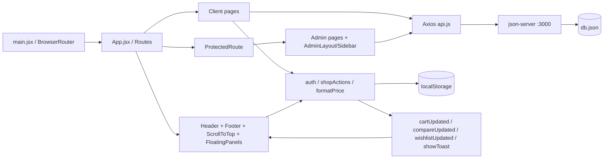
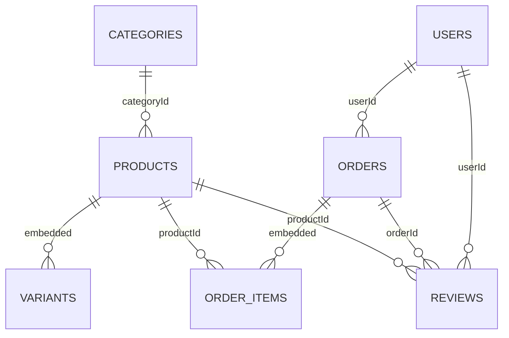

# TechMobile — tổng quan source thực tế

**Cập nhật 17/10/2026:** xác nhận đơn tự phân bổ FIFO trong domain command hiện có; không đổi store/kiến trúc hoặc db. Trang kho dùng GET /devices/summary (staff/admin) và danh sách IMEI phân trang theo cặp product/variant; OrderManager tự mở IMEI sau xác nhận. Bỏ nhãn Demo, giữ metadata; sidebar sticky dưới navbar đo bằng ResizeObserver, mobile thu gọn. UI fixture chạy cổng động với VITE_API_URL, mặc định API ứng dụng vẫn localhost:3000. Xem [IMEI_WARRANTY.md](IMEI_WARRANTY.md).

**Cập nhật sau triển khai IMEI/bảo hành 16/10/2026:** xem [IMEI_WARRANTY.md](IMEI_WARRANTY.md) cho kiến trúc/schema/quy tắc hiện hành. Các phần audit bên dưới giữ lại snapshot tiếp nhận để đối chiếu.

Hiện đã có `server/{index,domain,store}.cjs`, migration `scripts/migrate-imei.cjs`, kiểm thử domain/HTTP và UI headless. API vẫn json-server nhưng chạy qua module riêng kiểm lệnh và ghi snapshot. Thêm devices/warranties/warrantyClaims/inventoryOperations/inventoryMeta, quản lý một IMEI/máy, giữ chỗ variant, phân bổ/giao/hủy/nhận lại, bảo hành và lịch sử. Thêm routes `/admin/devices`, `/admin/warranties` (tổng 20 routes). Các component mới: OrderDevices, OrderDeviceAllocation, VariantEditor; các service/helper mới: operations, variants. Đã migration demo: 838 máy, 819 khả dụng, 18 quyền bảo hành, giữ toàn bộ giá trị có trước. Phiên đăng nhập token server thay cho so password trong browser.

Ngày tiếp nhận: **16/10/2026** (Asia/Saigon). Gốc workspace: `D:\STUDY\Công Nghệ Web\BTL\phone-store`.

## Phạm vi và độ tin cậy

Đã đọc toàn bộ 36 file JS/JSX trong `src`, hai file CSS (4.699 + 578 dòng theo PowerShell), README, package/lock metadata, Vite, ESLint, gitignore, HTML; phân tích sáu collection của db bằng schema/thống kê và kiểm tra đường dẫn assets. Không đọc `.env` hoặc xuất giá trị mật khẩu/thông tin cá nhân. Không sửa code ứng dụng hoặc db. README có thay đổi của người dùng từ trước và được giữ nguyên.

Đã chạy build/lint, kiểm tra dependency cục bộ và kiểm chứng một số handler với fixture trong bộ nhớ. Chưa chạy trình duyệt/E2E, chưa kiểm chứng responsive, máy in, tải QR hoặc giao dịch ngân hàng. Không xem một nhánh JSX tồn tại là bằng chứng tính năng đã chạy hoàn chỉnh. Xem [FEATURE_INVENTORY](FEATURE_INVENTORY.md) và [TECHNICAL_AUDIT](TECHNICAL_AUDIT.md).

## Mục tiêu, công nghệ và cấu hình

SPA bán điện thoại cho đồ án Công nghệ Web, có giao diện khách hàng và quản trị/nhân viên. Backend hiện chỉ là json-server đọc/ghi `db.json`; không có dịch vụ auth, transaction, ngân hàng, upload hoặc email riêng.

| Thành phần | Phiên bản lockfile/cài cục bộ | Vai trò |
|---|---|---|
| React / React DOM | 19.2.6 | Component và state |
| Vite / plugin React | 8.0.14 / 6.0.2 | Dev server, biên dịch; config chỉ đăng ký plugin React |
| React Router DOM | 7.15.1 | BrowserRouter, Routes, params/query |
| Axios | 1.16.1 | Instance dùng chung gọi API |
| json-server | 0.17.4 | REST CRUD sáu collection, cổng 3000 |
| Bootstrap | 5.3.8 | CSS grid, form, bảng, badge; main không import Bootstrap JS |
| Recharts | 3.8.1 | Bar/Pie chart dashboard |
| React Icons | 5.6.0 | Icon header/footer |
| ESLint | 10.4.0 | Recommended JS, hooks, refresh; globals browser; bỏ qua dist |

`package.json` khai báo dải phiên bản caret, nên khác patch với phiên bản thực tế là bình thường. `npm ls --depth=0` pass. Node dùng khi audit: 20.20.1; npm 10.8.2. Chưa thực hiện tra cứu CVE/npm audit, không kết luận dependency không có lỗ hổng.

`api.js:4` hardcode `http://localhost:3000`, chưa đọc `VITE_API_URL`, không có timeout/interceptor/token. README có ví dụ env và deploy nhưng đó chưa phải cấu hình đã triển khai. Vite chưa có proxy/base tùy chỉnh; BrowserRouter cần hosting fallback về index.html nếu triển khai sau này. Chưa có cấu hình deployment/CI trong source được kiểm kê.

`index.html` có Google Fonts Be Vietnam Pro, title Tech Mobile, hai favicon nhưng `/favicon.svg` không tồn tại; lang đang là en dù UI tiếng Việt. `.gitignore` bỏ node_modules, dist, `.env`, `.env.local`, một số log; không bỏ mọi biến thể `.env.*`. Không mở env để kiểm tra giá trị.

## Cấu trúc

```text
phone-store/
├── AGENTS.md                         # Hướng dẫn cho các lần làm việc sau
├── docs/                             # Năm tài liệu tiếp nhận
├── public/IMG/                       # 165 ảnh sản phẩm/biến thể/logo/avatar/hãng
├── src/
│   ├── App.jsx                       # 18 routes, khung chung
│   ├── main.jsx                      # BrowserRouter + thứ tự import CSS
│   ├── components/                   # 11 components
│   ├── pages/client/                 # 11 pages, bao gồm Compare.jsx
│   ├── pages/admin/                  # 7 pages
│   ├── services/{api.js,productService.js}
│   ├── utils/{auth.js,formatPrice.js,shopActions.js}
│   └── assets/css/{style.css,product-detail.css}
├── db.json                           # Dữ liệu demo, đang được Git theo dõi
├── package.json / package-lock.json
├── vite.config.js / eslint.config.js
├── index.html / .gitignore / README.md
├── node_modules/                     # Có sẵn; không audit source thư viện đầy đủ
└── dist/                             # Build sinh ra, bị gitignore
```

## Kiến trúc và state



Không có Context/store toàn cục. Pages giữ array/form/filter/modal bằng useState, tải API bằng useEffect. Dữ liệu giữa pages chủ yếu qua URL, localStorage, window events; prop liên kết chính là `product`, `productId`, `children`, `allowedRoles`, `order/onClose`.

Header đọc currentUser mỗi render nhưng không subscribe auth/profile changes. Login tải lại trang để phản ánh phiên. Các component chỉ subscribe một phần các event; xem lỗi đồng bộ trong audit. Phần lớn fetch catch chỉ console.log, thiếu loading/error riêng và không hủy request khi đổi route.

## Routes và quyền giao diện

| Route | Page | Quyền/điều kiện thực tế |
|---|---|---|
| `/` | Home | Công khai |
| `/products` | ProductList | Công khai, đọc query `search` |
| `/products/:id` | ProductDetail | Công khai; inactive vẫn xem được nhưng nút mua chính bị khóa |
| `/wishlist` | Wishlist | Công khai, dữ liệu trình duyệt |
| `/compare` | Compare | Công khai, page riêng ngoài modal |
| `/cart` | Cart | Công khai |
| `/checkout` | Checkout | Không bọc ProtectedRoute; handler submit yêu cầu currentUser |
| `/login`, `/register` | Login, Register | Công khai |
| `/orders` | OrderHistory | Page tự hiển thị yêu cầu đăng nhập nếu chưa có user |
| `/profile` | Profile | Effect tự điều hướng login nếu chưa có user |
| `/admin` | Dashboard | ProtectedRoute: admin/staff |
| `/admin/products` | ProductManager | admin/staff |
| `/admin/orders` | OrderManager | admin/staff |
| `/admin/categories` | CategoryManager | admin |
| `/admin/users` | UserManager | admin |
| `/admin/staffs` | StaffManager | admin |
| `/admin/coupons` | CouponManager | admin |

Có 18 khai báo Route, không có catch-all/404. Header/Footer luôn mount kể cả admin/auth; FloatingPanels mount toàn cục, chỉ ẩn panels và compare modal tại `/cart`, `/checkout`, `/orders`, mọi pathname bắt đầu `/admin`. Toast vẫn hiển thị ở các trang đó. ScrollToTop theo pathname, không theo query search.

## Vai trò từng module

### Components

| Module | Input → xử lý/output | Liên kết và điểm cần nhớ |
|---|---|---|
| AdminLayout | children → Bootstrap hai cột sidebar/nội dung | Mỗi admin page tự bọc layout |
| AdminSidebar | currentUser → link theo role | Staff thấy dashboard/products/orders |
| Header | keyword/currentUser → search URL, profile/orders/wishlist/logout | Avatar cố định, pill CSS; logout chỉ xóa currentUser |
| Footer | Không prop → chính sách/liên hệ/link tĩnh | Không có logic bảo hành thật |
| FloatingPanels | Đọc cart/compare, window events → mini panels, toast, modal thông số | useRef cuộn nội dung; overlay đóng; khóa body bằng modal-open; không có Escape/focus trap/cleanup route |
| ProductCard | product → ảnh lazy, giá, sao, tim, compare, add cart | Dùng helpers; wishlist liked chỉ init/theo product.id, không subscribe wishlistUpdated |
| ProductReviews | productId → GET reviews, strict filter, đảo thứ tự | Chỉ đọc review, không gửi; lỗi mạng có thể hiển thị như chưa có review |
| RatingStars | rating, size, showNumber → sao/số | Clamp 0–5; số thập phân chỉ tô sao nguyên |
| OrderInvoiceModal | order/onClose → snapshot, tổng tiền, window.print | Thiếu nhãn delivered, màu/variant; CSS print riêng |
| ProtectedRoute | children/allowedRoles → render hoặc Navigate | Chỉ tin localStorage.role; không kiểm tra trạng thái blocked hay API |
| ScrollToTop | pathname → window.scrollTo smooth | Không theo query |

### Client pages

| Page | Input, state và API | Output/nghiệp vụ |
|---|---|---|
| Home | GET products | Hero ảnh tĩnh, link hãng, top 5 theo reviews, tối đa 5 có oldPrice>price; không lọc inactive |
| ProductList | GET products, searchParams; tab/search/price/sort | Lọc tên/hãng, 4 khoảng giá, sort; bestseller dùng reviews, không dùng số bán; promo click reset/tab Apple |
| ProductDetail | id → GET product + toàn products; color/storage/compare/liked | Chọn variant cập nhật giá/ảnh/storage/color/cartKey; bảng specs chủ yếu từ product gốc; related không lọc inactive |
| Cart | getCart; local cart | Tăng/giảm tối thiểu 1, giới hạn tồn snapshot, xóa một/toàn bộ, tổng giá; không fetch giá/tồn mới |
| Checkout | cart/currentUser, form, coupon; GET coupons/products, POST order, PATCH products | Tạo pending/unpaid, snapshot item, trừ kho tuần tự rồi clear cart; BANK chỉ là option |
| Compare | compareList local; getSpecs riêng | Bảng riêng, xóa/xóa hết không emit compareUpdated, thêm cart bằng logic riêng theo id |
| Wishlist | getWishlist + wishlistUpdated | Card, thêm cart/compare/xóa; snapshot wishlist không có quantity/variant/full specs |
| Login | account/password → GET toàn users | So sánh plain password, chặn blocked, lưu user bỏ password; reload tới admin hoặc home |
| Register | Form → GET users kiểm tra trùng, POST users | Customer active, ID timestamp string, password >=6; không tự đăng nhập |
| Profile | currentUser → form; GET users/user, PUT user | Sửa tên/email/phone/address/password; giữ oldUser trong PUT; không yêu cầu password cũ |
| OrderHistory | currentUser → GET toàn orders + reviews | Strict filter userId; hủy pending + hoàn kho, delivered→completed/COD paid, review, invoice |

### Admin pages

| Page | Input/API | Output/nghiệp vụ |
|---|---|---|
| Dashboard | GET products/users/orders | Counts, revenue completed, chart tháng/trạng thái, roles, stock <=0/1–5, 5 đơn cuối array, CSV |
| ProductManager | GET products/categories; POST/PUT product; PATCH status | Form thông số phẳng, tìm tên/hãng, lọc hãng/tồn, ảnh URL/preview; không quản lý variants; PUT mất trường không đưa vào form |
| CategoryManager | GET categories/products, POST/PUT category | Danh mục/count theo categoryId strict; DELETE handler có nhưng nút comment |
| UserManager | GET/POST/PUT/PATCH users | Quản lý mọi role, tìm/lọc, khóa/mở; không chỉ customer. DELETE handler có nhưng nút comment |
| StaffManager | GET/POST/PUT/PATCH users | Filter admin/staff, form gần trùng UserManager, khóa/mở; DELETE không có nút hoạt động |
| OrderManager | GET orders, PATCH order/products | Search ID/tên/phone, lọc status, next-step buttons, cancel, manual BANK payment, invoice; không có payment filter |
| CouponManager | GET/POST/PUT/PATCH coupons | Percent/amount, trùng mã không phân biệt hoa thường, kích hoạt/ngừng; DELETE nút comment |

### Services và utilities

- `api.js`: chỉ tạo Axios instance, dùng nhất quán endpoint `/products`, `/users`, `/categories`, `/orders`, `/reviews`, `/coupons`.
- `productService.js`: thực chất bản ProductCard cũ với JSX trong `.js`, không được import. Có add-cart riêng gộp theo id, thiếu event/validation; không nằm trong bundle ứng dụng hiện tại.
- `auth.js`: get/save currentUser và logout. JSON.parse không có fallback cho chuỗi JSON hỏng; logout không xóa cart/compare/wishlist.
- `formatPrice.js`: `Number(price).toLocaleString('vi-VN') + 'đ'`; không xác thực số hữu hạn.
- `shopActions.js`: get/save cart/compare, add/remove cart, compare toggle tối đa 3, toast event, wishlist get/save/check/toggle/remove. addToCart kiểm tra active và quantity snapshot, merge bằng cartKey hoặc id. Wishlist so sánh ID qua String, compare/cart thường strict equality.

## API đọc/ghi và quan hệ

| Collection | Đọc từ | Ghi từ |
|---|---|---|
| products | Home/List/Detail, Checkout, Dashboard, Product/Category managers, cancellation handlers | ProductManager POST/PUT/PATCH status; Checkout PATCH quantity; OrderHistory/OrderManager PATCH hoàn kho; OrderHistory PATCH rating/reviews |
| users | Login/Register/Profile, Dashboard, User/Staff managers | Register POST customer; Profile PUT; User/Staff POST/PUT/PATCH status |
| categories | ProductManager/CategoryManager | CategoryManager POST/PUT |
| orders | OrderHistory/OrderManager/Dashboard | Checkout POST; history/manager PATCH status/payment/cancel |
| reviews | ProductReviews/OrderHistory | OrderHistory POST |
| coupons | Checkout/CouponManager | CouponManager POST/PUT/PATCH status |

DELETE users/orders/categories/coupons chỉ tồn tại trong handler không có UI gọi hoạt động. Không kết luận người dùng hiện có nút xóa đơn/sản phẩm. Không có API variants riêng, wishlist/compare/cart API, auth endpoint hoặc webhook.

## Schema thực tế `db.json`

Các số liệu là snapshot audit, không phải ràng buộc được backend thực thi. Không có FK/unique/schema validation server riêng.

| Collection | Số bản ghi | ID | Trường/quan hệ |
|---|---:|---|---|
| users | 4 | string | fullName, username, email, password, phone, address, role, status, createdAt; 1 admin/2 staff/1 customer; tất cả active |
| categories | 8 | string | name, description |
| products | 35 | string | name, brand, categoryId→categories, image, price/oldPrice/msrp, rating/reviews, screen/chip/ram/storage/rom/camera/battery/charge, quantity, description, status, sáu nhóm specs, variants; tất cả active |
| orders | 23 | 1 number, 22 string | userId→users, customerName, items[], totalPrice, receiverName/phone/address/note, paymentMethod, status, createdAt; các trường tùy thế hệ dữ liệu bên dưới |
| reviews | 5 | string | orderId/productId/userId (string), userName, rating, comment, createdAt |
| coupons | 3 | string | code, discount:number, status; discountType chỉ có ở 1 bản ghi amount, 2 bản ghi thiếu và được UI coi là percent |

Product specs:

```text
memory {ram, storage, card}
displayCamera {display, rearCamera, frontCamera}
batteryCharge {battery, charge, wireless}
utilities {security, waterResistant, special}
connection {sim, network, port}
design {material, weight, color}
variants[] {id:string, color, storage, price:number, oldPrice:number, image, ram?:string}
```

35 sản phẩm đều có variants, tổng **274 biến thể**. Không variant nào có quantity; tồn chỉ ở product.quantity. Snapshot hiện có đủ tổ hợp color×storage cho mỗi sản phẩm, nên tổ hợp không tồn tại là rủi ro với dữ liệu mới, chưa phải lỗi đang có trong db.

35 order items: `{productId:number|string, name, price:number, quantity:number, image}`. Có 1 productId number, 34 string. Không có variantId/cartKey/color/storage tách biệt. Tên mới từ detail có thể chứa dung lượng, không đủ định danh màu/biến thể.

Order có field theo số bản ghi: paymentStatus 9/23; productTotal/productDiscount 14/23; coupon/couponDiscount 19/23; cancelReason/cancelledBy/cancelledAt 3/23; deliveredAt 5/23; completedAt 4/23; paidAt/paidBy 5/23. createdAt/cancelledAt/... là chuỗi ngày kiểu vi-VN, chưa có thời gian/múi giờ chuẩn ISO.

Có 12 completed, 9 cancelled, 1 pending, 1 delivered. 22 COD, 1 BANK. Trong completed: 5 paid, **7 thiếu paymentStatus**; không tự diễn giải 7 đơn này chắc chắn chưa thu tiền. Toàn bộ orders: 7 paid, 2 unpaid, 14 thiếu field.

Không thấy FK mồ côi khi chuẩn hóa ID bằng String; có 1 strict mismatch item.productId→product.id. Không có ID trùng sau chuẩn hóa, tồn âm, tồn không nguyên, review trùng khóa user/order/product hoặc review trỏ tới đơn chưa completed trong snapshot. Đây không phải bằng chứng code ngăn được các lỗi đó.



Coupon được copy vào order, không giữ FK couponId. Wishlist/compare/cart lưu snapshot trình duyệt, không liên kết userId. Không có collection IMEI, warranty, transaction, banner, audit log.

## Toàn bộ localStorage và event

| Key | Writer | Reader | Đồng bộ và phạm vi |
|---|---|---|---|
| currentUser | auth.saveCurrentUser từ Login/Profile; auth.logout remove | auth.getCurrentUser từ Header/Sidebar/ProtectedRoute/Checkout/Profile/OrderHistory | Không có auth event; không kiểm tra server mỗi thao tác; login snapshot không lưu password |
| cart | shopActions.saveCart; Compare.handleAddCart; productService cũ | helpers, Cart, Checkout, FloatingPanels, Compare, productService cũ | saveCart và Compare add emit cartUpdated; productService không emit; Cart/Checkout chỉ đọc lúc mount |
| compareList | shopActions.saveCompareList; Compare.saveCompareList/handleClear | helpers, ProductCard/Detail, FloatingPanels, Compare | Helper emit compareUpdated; page Compare không emit khi xóa/clear và không subscribe |
| wishlist | shopActions.saveWishlist/toggle/remove | helpers, ProductCard/Detail, Wishlist | toggle/remove emit wishlistUpdated; save riêng không emit; chỉ Wishlist subscribe |

FloatingPanels còn nghe native storage event để cập nhật cart/compare từ tab khác. Các component khác không đồng bộ đầy đủ giữa tab. Tất cả bốn key dùng chung origin, không có namespace theo tài khoản/validate version/try-catch parse.

## Luồng chính

1. Khách xem Home/List, query search ở Header truyền sang ProductList; ProductCard nhận product qua prop. Detail gọi API theo id, chọn variant để tạo displayProduct và cartKey `productId-variantId`.
2. Add cart lưu toàn product snapshot + cartQuantity, emit cartUpdated. Cart chỉnh số lượng dựa tồn snapshot. Wishlist hiện bỏ quantity/variant khi copy, Compare có đường ghi cart riêng.
3. Checkout đọc storage lúc mount, tính giá từ cart, apply coupon bằng GET coupons. Khi submit: kiểm tra user/form; GET từng product kiểm tra active/tồn từng dòng; POST order trước; GET/PATCH tồn từng dòng; clear cart và tới orders. Không có transaction/khóa/nút chống submit lặp, không đối chiếu giá mới hoặc biến thể.
4. OrderManager chuyển pending→confirmed→shipping→delivered bằng nút. Khách OrderHistory xác nhận delivered→completed; COD đồng thời paid/paidAt/paidBy. BANK quản trị đánh dấu thủ công, không có QR/nội dung chuyển khoản/webhook.
5. Hủy đơn: form lý do, GET/PATCH hoàn kho từng item trước, cuối cùng PATCH cancelled. Không có stockRestored hay điều kiện phiên bản server. Vì vậy có thể xử lý lặp hoặc dở dang.
6. Review: nút ở completed, kiểm tra khóa local reviews, POST review rồi fetch tính rating và PATCH product. Invoice đọc order snapshot, không truy ngược tên/giá hiện tại.
7. Dashboard tổng hợp toàn bộ dữ liệu client-side, revenue theo completed và createdAt; chart tháng gộp mọi năm, CSV nhóm tháng/năm riêng.

## CSS, assets và giao diện

Thứ tự import: Bootstrap → style.css → product-detail.css tại main; Detail còn import lại cùng file (Vite xử lý cùng module). product-detail.css là global, nên `.product-not-found` ở đó tác động cả trang khác.

- style.css có 266 tên class, 187 có token tham chiếu tĩnh/dynamic nhận diện được; 79 là ứng viên không tham chiếu. product-detail.css có 37 class đều có tham chiếu. Đây là thống kê từng file, không phải tổng unique giữa hai file; scan AST/token không thay thế kiểm tra DOM/CSS coverage. Danh sách đầy đủ ở mục 7 của TECHNICAL_AUDIT.
- Nhóm đang dùng: site-header/header-shell/navbar-*, product/filter/promo/card, home-*, right-floating-panels/mini-*, compare-*, toast-*, profile-*, review-*, invoice-*, rating-*, admin-stat/stat-*/dashboard-*, detail/spec/related/option-*; Bootstrap còn cung cấp row/col/card/table/form/btn/badge và utility.
- Có nhiều block compare/modal/mini-panel/toast lặp. `!important` của floating panels giữ top/width/max-height desktop trước media mobile; `.btn-primary` sửa toàn cục width 100%; selector `quick-specs-section` thiếu dấu chấm; font ban đầu Montserrat bị Be Vietnam Pro ghi đè. Chi tiết và danh sách class nằm tại audit.
- Giữ giao diện hiện tại theo yêu cầu; chưa chỉnh cascade hay kết luận responsive đẹp trên mọi viewport.
- 165 file public/IMG; 122 đường dẫn ảnh/favicon distinct tìm được từ source và snapshot order/product/variants. Hai đường dẫn thiếu: `/favicon.svg`, `/IMG/samsung-galaxy-z-flip7-jet-black.jpg` (hai variants của product `4`). Các ảnh còn lại đã kiểm tra tồn tại trên đĩa, chưa kiểm tra tất cả nội dung ảnh bằng thị giác.
- Đã xem trực tiếp logo.png và hero iphone-15.png: đọc được. ProductCard dùng loading lazy, các ảnh khác chủ yếu không có fallback; Profile và ProductManager preview có xử lý lỗi riêng. Ảnh local dùng `/IMG/...`, cần giữ chính xác tên/case khi deploy sang hệ thống phân biệt hoa thường. Font từ Google cần mạng.

## Chạy và tài liệu tiếp theo

`npm.cmd run server` và `npm.cmd run dev` trong hai terminal; build bằng `npm.cmd run build`, lint bằng `npm.cmd run lint`, preview bằng `npm.cmd run preview`. Không có test script. Không cần cài json-server global khi đã cài dependency cục bộ.

Xem [BUSINESS_RULES](BUSINESS_RULES.md) để phân biệt thực thi và mục tiêu, [ROADMAP](ROADMAP.md) để chọn công việc tiếp theo. Các đề xuất chưa được triển khai.
